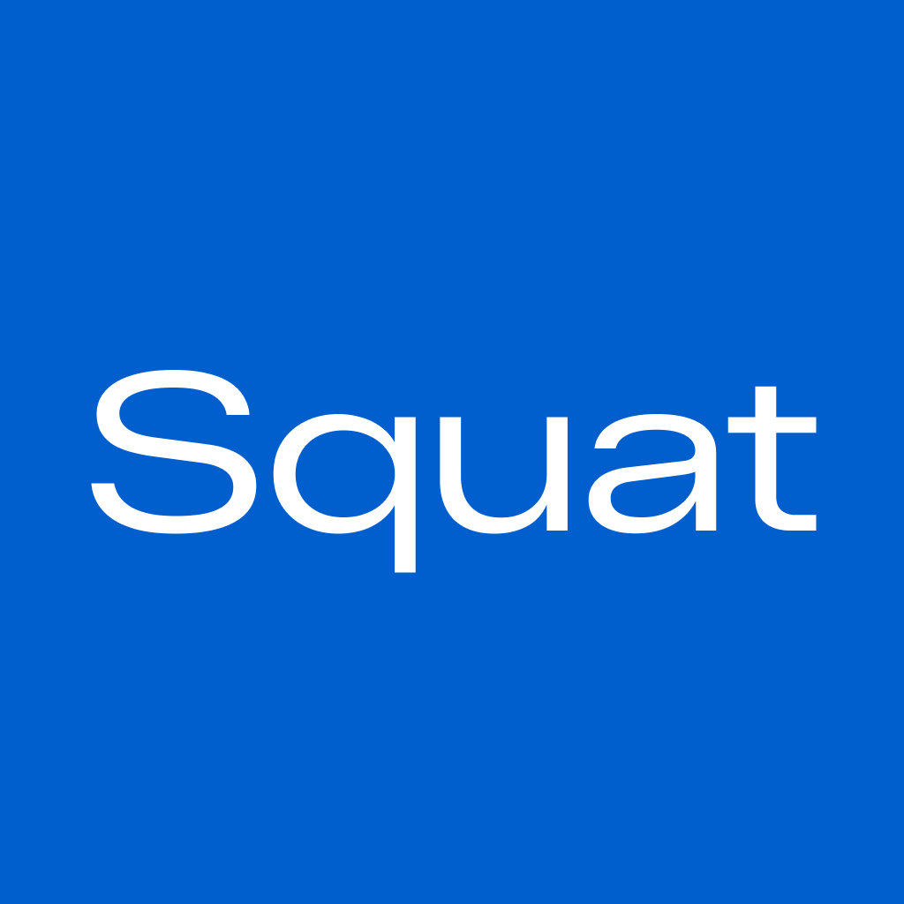
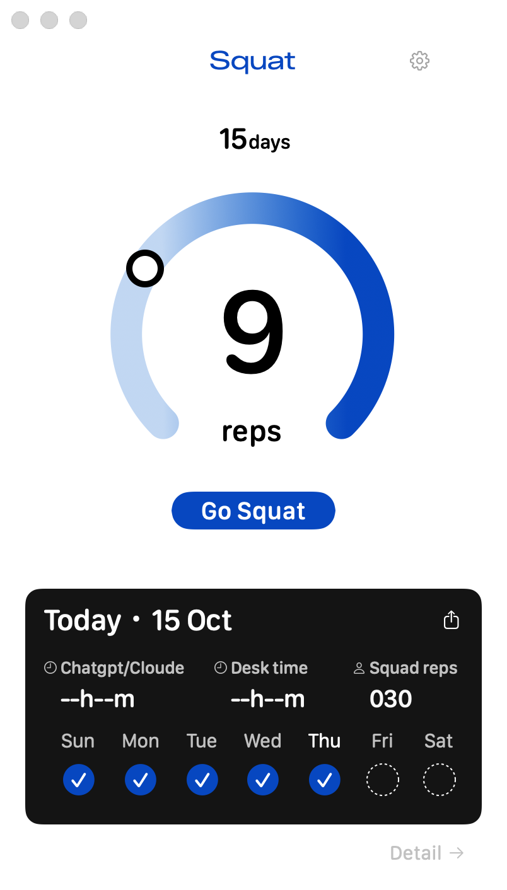
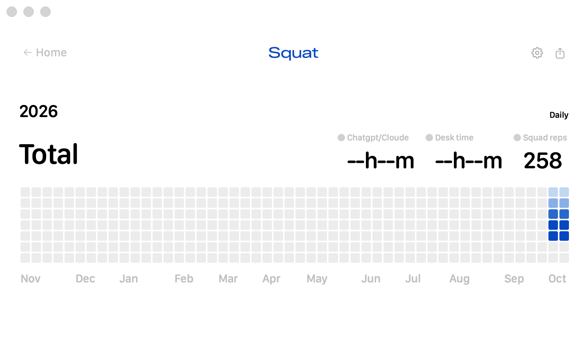

<p align="center"></p>

# Squat for Mac

**AIを使う時間に、小さな運動のきっかけを。**

ChatGPT/Codex・Claudeの利用時間を数え、運動を案内するMacのメニューバーアプリです。カメラで上下の動きを数え、日々の記録を残せます。

[English](README.md) · [使い方・FAQ](docs/USER_GUIDE.md) · [プライバシー](PRIVACY.md) · [監査](docs/AUDIT.md) · [残課題](docs/KNOWN_ISSUES.md)

> **0.9.1・非公開での事前確認版。** 公開ダウンロードとAppleの公証はまだありません。コードの公開ライセンスは未決定で、現時点ではオープンソースとしての公開ではありません。

## ダウンロード

[確認版0.9.1](https://github.com/rin999999334/squat-for-mac/releases/tag/v0.9.1)のAssetsからarm64版のZIPを選びます。GitHubは非公開のため、権限のあるアカウントでログインしてください。[初回の開き方とプレビュー](docs/DOWNLOAD.md)。

## 画面

**デモデータです。** アプリの実際の画面を、架空の日付・運動記録で撮影しています。個人の記録は含みません。

<p align="center"></p>

<p align="center"></p>

[設定](Assets/screenshots/settings-demo.png) · [Todayの共有画像](Assets/screenshots/today-card-demo.png) · [Totalの共有画像](Assets/screenshots/total-card-demo.png) · [メニューの表示例・時間はダミー](Assets/screenshots/menu-demo.png) · [撮影方法](Assets/screenshots/README.md)

## できること

- 選択したMac版ChatGPT/Codex・Claudeの、前面での利用時間を計測します。両方開いていても二重には数えず、通知までの時間は合算します。
- メニューバーから、今日のChatGPT/Codex・Claudeそれぞれの時間と、次の通知までに必要なAI利用時間を確認できます。
- 通知の間隔は30・60・90・120・180分。運動しなかった場合は、次の通常間隔と45分後のうち、早い方で1回カウントダウンの再通知を待機します。
- 目標1〜30回の運動を、カメラとStart・End・Challengeのラインで補助します。
- 日ごとの記録・カレンダー・TodayとTotalの共有画像を表示します。
- 日本語・英語、PC利用時間の任意の計測、柔らかい効果音に対応します。

カメラ処理はMac内で行い、映像の保存・送信はしません。通常利用にアクセシビリティ権限は不要です。アカウント登録・アプリ独自の利用解析・クラウド同期はありません。保存する情報と共有時の注意は[プライバシー説明](PRIVACY.md)を参照してください。

## 手元で起動する

現時点の確認環境は**Apple Silicon**です。対象OSの設定はmacOS 13以降ですが、Intelと対象OS全体の実機確認は未完了です。

Appleのコマンドライン開発ツールが利用できる環境で、リポジトリのルートから実行します。

```sh
./scripts/build.sh
open "dist/Squat for Mac.app"
```

既定ではローカル用の署名です。Developer IDでの署名・Appleの公証は行っていません。ダウンロードしたアプリはmacOSに止められる場合があります。[Appleの案内](https://support.apple.com/ja-jp/102445)を確認してください。Mac全体のセキュリティ保護を無効にする必要はありません。

1. 設定で、計測するAIアプリをONにします。
2. 通知をONにして間隔を選びます。通知タイミングは「利用時間」を使います。
3. **Go Squat**を押し、運動するときにカメラを許可します。

ウィンドウを閉じてもメニューバーに残ります。「終了」すると計測も止まります。ログイン時の自動起動は登録しません。

## 先に知っておいてほしいこと

- AI利用時間は、対象のMacアプリを前面で使った時間です。ブラウザ版・背面での生成時間・送信回数の計測ではありません。ChatGPTとCodexは共通の時間です。
- 「次の通知まで」はAI利用の残り時間です。別のアプリを使う間や5分以上操作がない間などは減りません。
- 通常のChatGPT/Claudeの送信・回答完了検知は対応していません。任意のCodex連携は実験段階で、同梱ヘルパーの接続先と通常版の不一致が残っています。日常利用は時間方式を使ってください。
- カメラの顔位置の上下移動を数えます。スクワットの正しいフォームを判定する機能ではありません。
- X・Instagramへの画像添付は手動です。画像を保存して投稿画面から追加します。自動投稿は行いません。
- 記録はMac内に保存します。クラウド同期や専用の書き出し・読み込み画面はありません。更新前にはバックアップしてください。

詳しくは[使い方・FAQ](docs/USER_GUIDE.md)を参照してください。

## フィードバック

通常の問い合わせは[Contact us](https://forms.gle/1ZvABbbDHBRJsd529)へ。セキュリティの懸念は[SECURITY.md](SECURITY.md)を参照し、公開Issueに個人情報や悪用の手順を載せないでください。

`rin999999334/squat-for-mac` を非公開で作成し、ソースと説明資料を保存しました。[公開前の確認事項](docs/RELEASE_PLAN.md)を終えるまでは非公開を維持します。公開後、役立ちそうであればStarで保存してもらえるとうれしいです。

非公開の確認段階ではプロジェクトの権利を留保します。コードの利用・改変・再配布のライセンスは未決定です。同梱する第三者の素材は、それぞれの[ライセンス](THIRD_PARTY_NOTICES.md)に従います。
